<div align="center">
  
</div>

<br>

```text
$ whoami
0xF8D, cybersecurity specialist and student in Saudi Arabia

$ cat focus
web application pentesting, OWASP Top 10, Linux and Windows exploitation
```

## Toolbox

| | |
|---|---|
| **Offensive** | `Burp Suite` `Nmap` `Wireshark` |
| **Build** | `Python` `PHP` `JavaScript` `HTML` `CSS` `SQL` `MySQL` `Git` |
| **Systems** | `Linux` `Windows` `TCP/IP` `HTTP/HTTPS` |

## Projects

| Project | What it is |
|---|---|
| [**emdad**](https://github.com/0xF8D/emdad) | Logistics command-and-control web platform with backend APIs and a database to manage equipment supply, requests, and assets. |

Lab write-ups are on the way.

## Practice

40+ rooms completed on TryHackMe, covering SQL injection, OWASP Top 10, Linux fundamentals, password hash cracking, and Windows exploitation.

<br>

<div align="center">

[](https://tryhackme.com/p/0xF8D)
[](https://www.youtube.com/@0xF8D)

</div>
